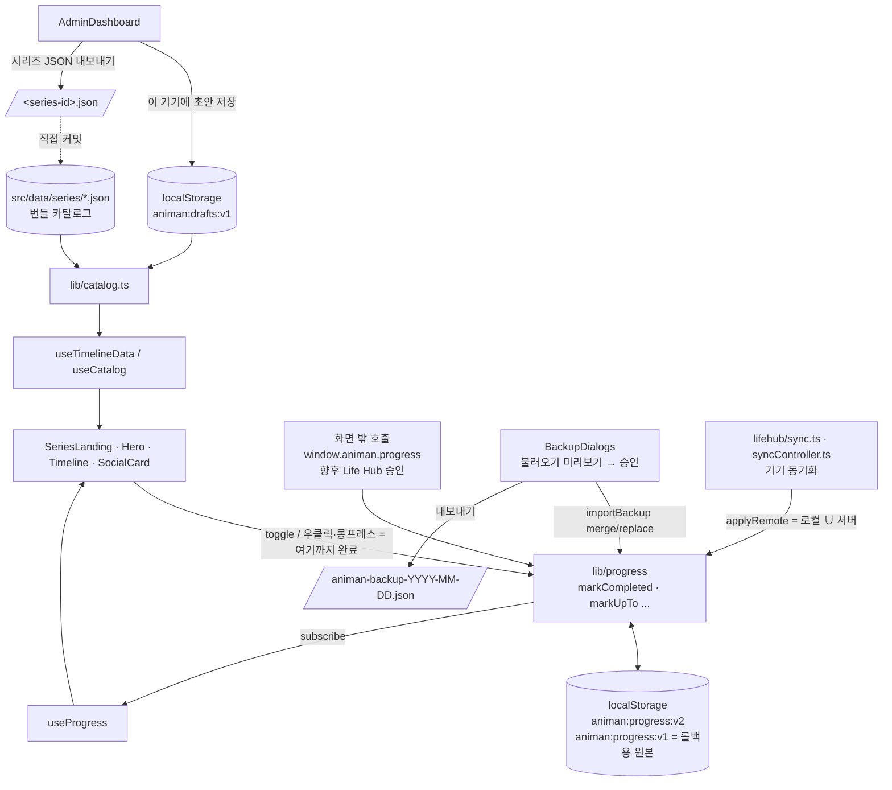
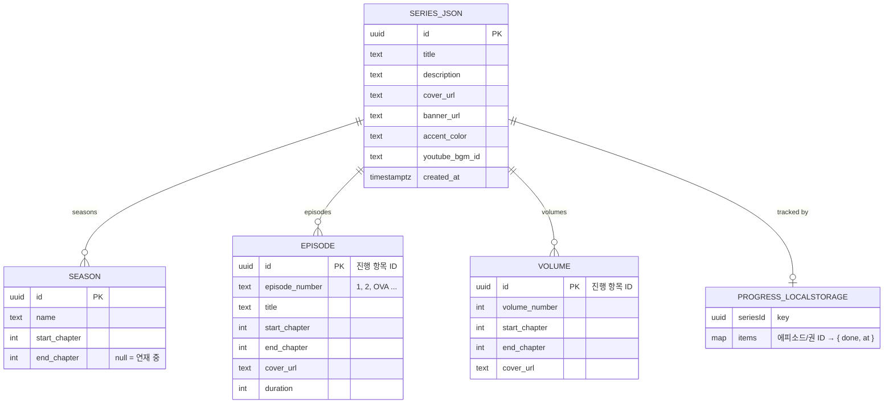
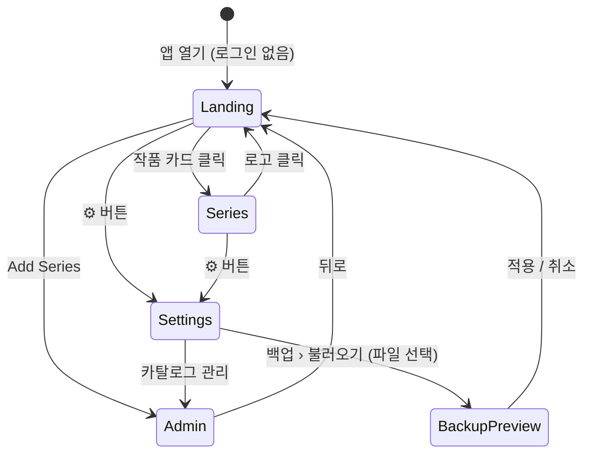

# AniMan Timeline Tracker

애니메이션 에피소드를 원작 만화 챕터 범위에 매핑해 타임라인으로 보여 주고, 어디까지 봤는지/읽었는지 기록하는 개인용 앱입니다.

- **서버 없음.** 시리즈 데이터는 이 저장소의 JSON으로 번들되고, 진행 기록은 **이 브라우저의 localStorage**에만 저장됩니다.
- **로그인 없음.** 이 기기 = 소유자입니다. 다른 기기로 옮길 때는 JSON 백업을 내보내고 불러오거나, (선택) Life Hub 기기 동기화를 켭니다.
- GitHub Pages로 정적 배포됩니다.

> ⚠️ 공개 저장소입니다. 개인 진행 기록 백업(`animan-backup-*.json`), 토큰·키는 커밋하지 마세요. `.gitignore`가 백업 파일 이름 패턴과 `.env*`를 막아 둡니다.

---

## Architecture

```
src/
├── App.tsx                    # 화면 전환 (landing / series / admin)
├── data/series/*.json         # 번들 카탈로그 — 시리즈당 1파일 (공개 데이터)
├── components/
│   ├── SeriesLanding.tsx      # 작품 목록 + 진행률, ⚙ 설정·제안 버튼 자리
│   ├── SettingsSheet.tsx      # ⚙ 설정 시트: Life Hub · 백업 · 카탈로그 관리
│   ├── LifeHubSettings.tsx    # 설정 › Life Hub 섹션 (연결·지금 동기화·고급)
│   ├── LifeHubMenu.tsx        # Claude 제안 목록 (제안이 있을 때만)
│   ├── BackupMenu.tsx         # 백업 섹션 + 불러오기 미리보기·오래 쉰 기기 검토 대화상자
│   ├── Header.tsx             # 시리즈 화면 상단 바
│   ├── Hero.tsx               # 시리즈 히어로 + 진행 바 + BGM
│   ├── Timeline.tsx           # 에피소드 ↔ 권 타임라인 (PC + 모바일)
│   ├── TimelineNode.tsx       # 타임라인 항목 (접근성 지원)
│   ├── SocialCard.tsx         # 공유용 진행 카드
│   ├── AdminDashboard.tsx     # 로컬 편집 → 시리즈 JSON 내보내기
│   └── ErrorBoundary/
├── hooks/
│   ├── useProgress.ts         # 진행 기록 구독 (반환 형태는 기존과 동일)
│   ├── useCatalog.ts          # 카탈로그(번들 + 로컬 초안) 구독
│   ├── useTimelineData.ts     # 선택한 시리즈 → TimelineData
│   ├── useHoverMapping.ts     # 챕터 범위 겹침 하이라이트
│   └── useAccentColor.ts
├── lib/
│   ├── progress/              # ★ 진행 기록을 바꾸는 유일한 모듈 (React 비의존)
│   │   ├── model.ts           #   v2 형식(항목별 { done, at }), 정규화, 묘비 정리, 시각 찍기 (순수 함수)
│   │   ├── merge.ts           #   v2 병합(항목별 마지막 쓰기 우선) — 교환·결합·멱등 (순수 함수)
│   │   ├── store.ts           #   markCompleted / unmarkCompleted / toggleCompleted / markUpTo / importBackup / applyRemote
│   │   ├── backup.ts          #   백업 형식(v2 내보내기, v1·v2 가져오기), 검증, 불러오기 미리보기
│   │   └── index.ts           #   공개 API (window.animan.progress 로도 노출)
│   ├── board/                 # 보드 타일 목록(manifest v1)을 만드는 순수 함수 (tiles.ts) + 예시 상태(sampleState.ts)
│   ├── catalog.ts             # 번들 JSON + 로컬 초안 병합, TimelineData 변환
│   ├── seriesBuilder.ts       # Admin 입력 ↔ 시리즈 레코드 (ID 유지)
│   ├── storage.ts             # 안전한 localStorage 래퍼
│   └── download.ts
└── types/index.ts
```

### Data Flow



### Data Model



필드 이름은 기존 Supabase 컬럼명과 같고, **모든 id는 기존 UUID를 그대로 유지**합니다. 화면·훅이 보는 완료 목록(`{ [seriesId]: completed_ids }`)은 Supabase 시절 형식 그대로이고, 저장은 항목마다 시각을 찍은 v2(아래)에서 파생합니다.

### View Flow



---

## 진행 기록 API (화면 밖에서도 사용)

진행 기록은 `src/lib/progress`만 바꿉니다. React 컴포넌트, 콘솔, 향후 Life Hub 연동(Claude 제안 → 앱에서 승인) 모두 같은 함수를 씁니다.

```ts
import { markCompleted, markUpTo, unmarkCompleted, toggleCompleted, importProgress, getProgress } from './lib/progress';

markCompleted(seriesId, ['<episode-or-volume-id>']); // 합집합, 새로 추가된 ID 반환
markUpTo(seriesId, 'episode', 12);                    // 원작 챕터 순서로 12화까지 완료
markUpTo(seriesId, 'volume', 3);                      // 3권까지 완료
unmarkCompleted(seriesId, ['<id>']);
importProgress({ [seriesId]: ['<id>'] }, 'merge');    // 'merge'(항목별 마지막 쓰기 우선) | 'replace'(완료 집합을 같게)
```

`getProgress()`는 화면용 완료 목록, `getProgressV2()`는 체크 해제 흔적(묘비)까지 포함한 전체 기록입니다.

브라우저 콘솔에서는 `window.animan.progress.markUpTo(...)` 로 같은 API를 호출할 수 있습니다.

### 저장 형식과 백업 형식 (v2)

```json
{ "app": "animan", "version": 2, "exportedAt": "2026-01-01T00:00:00.000Z",
  "progress": { "<seriesId>": { "<episode-or-volume-id>": { "done": true, "at": "2026-01-01T00:00:00.000Z" } } } }
```

- 저장: `localStorage` `animan:progress:v2`(위 형식 그대로). 구 `animan:progress:v1`은 v2 키가 없을 때 **한 번만** 변환하고 **지우지 않습니다**(롤백용). 변환할 때 각 id는 `done:true`, `at`은 `1970-01-01T00:00:00.000Z`(다른 기기의 실제 체크·해제가 항상 이기도록).
- `done:false`는 체크 해제 **묘비**입니다. 항목마다 `at`이 더 늦은 쪽이 이기고(같으면 `done:true`), 180일 넘은 묘비는 쓸 때만 지웁니다.
- 구형 v1 백업 파일(`"version": 1`, id 배열)도 그대로 가져올 수 있습니다(모든 id가 `done:true`, `at` = 파일의 `exportedAt`).

작품 목록 화면 오른쪽 위 **백업 내보내기 / 불러오기**. 불러오기는 미리보기(작품별 현재 → 적용 후, 추가/제거 수, 카탈로그에 없는 ID 경고)를 보여 주고, **합치기(기본, 항목별 마지막 쓰기 우선)** 또는 덮어쓰기(사라지는 항목은 묘비가 됨)를 고른 뒤 **적용**해야 반영됩니다. 이 수동 내보내기/가져오기는 Life Hub 없이도 되는 비상용 경로입니다.

---

## Life Hub로 진행 제안 받기 (선택)

Claude에게 "주술회전 2기 5화까지 봤어", "최애의 아이 만화 7권까지 읽었어"처럼 말하면 Claude가 [Life Hub](https://github.com/KINGJNU-sakayume/life-hub)에 **진행 제안**(`media_progress`)을 남기고, AniMan이 받아 온다.

- 헤더 톱니(**설정**) › **Life Hub** 섹션에서 한 번 연결한다(배포 주소에서만). 연결·해제·「지금 동기화」 버튼은 이 섹션에만 있다. OAuth 공개 클라이언트(`public/lifehub-client.json`, PKCE), `animan:inbox animan:sync animan:board`를 요청한다. 동기화 권한을 실제로 주는지는 동의 화면의 「기기끼리 동기화도 허용」 체크가 정한다(체크하지 않아도 제안 가져오기는 그대로 된다). Life Hub는 `public/lifehub/`로 돌아온다.
- 제안이 1건 이상일 때만 첫 화면에 **Life Hub** 버튼(숫자 배지)이 나타나고, 누르면 제안 목록이 열린다. 0건이면 버튼이 없다. 작품 제목(또는 괄호 안 원제)이 하나로 맞을 때만 자동 선택, 애매하면 고른다. 카탈로그에 없는 작품은 추가한 뒤 다시 확인.
- "N화/권까지"는 타임라인 순서로 그 앞까지 모두, 번호 목록은 그것만. "2기 5화"는 시즌의 챕터 범위로 바꿔 계산한다(`src/lifehub/resolve.ts`). 기록 전에 새로 완료될 개수를 보여 준다.
- 「기록」은 `markCompleted`(지우지 않음), 「거절」은 변경 없음. 승인(시리즈 ID)·거절 결과는 동기화 때 Life Hub로 보내고 응답이 올 때까지 다시 보낸다(localStorage `animan.lifehub.*`).
- **Claude 대화 카드**에서 승인한 진행은, 작품이 하나로 정해지고 요청한 번호가 모두 있을 때 앱을 열면 바로 완료로 표시한다(설정 › Life Hub 「Claude에서 승인한 기록은 바로 반영」, 기본 켜짐). 아니면 위 목록에서 「Claude 카드에서 승인함」으로 기다린다.
- 카드의 작품 이름 제안을 위해 카탈로그의 **작품 id·제목·강조 색**만 Life Hub에 공유한다(바뀔 때만). 진행 기록은 보내지 않는다.

## Life Hub로 기기끼리 동기화 (선택)

Life Hub의 `/animan/v1/sync`에 진행 기록 v2 문서를 한 개 보관해 여러 기기의 기록을 맞춥니다([life-hub `docs/P6_SYNC.md`](https://github.com/KINGJNU-sakayume/life-hub/blob/main/docs/P6_SYNC.md)가 계약). 코드는 `src/lifehub/sync.ts`(한 번의 동기화), `syncController.ts`(언제 할지), 화면은 설정 › Life Hub 섹션(상태 줄, 「지금 동기화」, 접힌 「고급」의 기기 이름).

- **켜기:** 따로 없다. Life Hub에 연결되어 있으면 동기화는 켜진 것으로 동작한다(예전 저장값이 꺼짐이어도 앱 시작 시 켜짐으로 바꾼다). 토큰에 동기화 권한이 없으면 설정 톱니에 점이 생기고 「확인 필요 — 동기화 권한이 없는 연결」과 「다시 연결」이 보인다(제안 가져오기는 그대로 된다).
- **언제:** 앱 시작·탭이 다시 보일 때 가져오고(폴링 없음), 변경 5초 뒤·탭이 숨겨질 때 올린다. 한 번에 하나만 돈다.
- **어떻게:** `GET /sync/meta` → 서버 version이 다르거나 올릴 변경이 있으면 `GET /sync` → 로컬 ∪ 서버로 병합 → 다르면 `PUT`(`If-Match: "<version>"`, 최초는 `If-None-Match: *`). `412`면 다시 읽고 병합해 최대 3번. 로컬에는 언제나 병합 결과만 쓰고, 실패해도 로컬 기록은 그대로다.
- **멈춤:** `413`(너무 큼)·`400/415/428`(오류)는 자동 동기화를 멈추고 알린다. 180일 넘게 동기화하지 않은 기기는 자동 병합하지 않고, 「서버 문서 검토」를 거쳐야만 풀린다: 다른 기기에서 이미 지워진 것으로 보이는 항목(마지막 동기화 시각 F 이하이고 서버에 없는 로컬 항목)을 목록으로 보여 주고, 현재 로컬 진행도 내려받기를 권한 뒤, 확인하면 그 항목을 묘비 없이 지우고 나머지를 병합해 동기화한다. 취소하면 아무것도 바뀌지 않는다.
- **끄기·롤백:** 「연결 해제」를 하면 제안과 동기화가 모두 멈추고 이 기기는 Life Hub와 주고받지 않는다(이 기기의 기록은 지우지 않는다). `animan:progress:v1`은 남아 있고(옛 빌드로 되돌릴 수 있음), 수동 JSON 내보내기/가져오기는 그대로 쓸 수 있다.

## 보드 타일

[Life Board](https://github.com/KINGJNU-sakayume/board)에 **최근 흐름**(지금 보는 것, 최근에 끝낸 것, 다음 차례)을 타일로 보냅니다. "이번 주 몇 편" 같은 거시 통계는 보내지 않습니다. 보내는 것은 보드용 목록(manifest v1)뿐이고, 진행 기록 자체는 올리지 않습니다. 모양은 보드가 정하고 이 저장소는 데이터만 만듭니다(규격: board `docs/TILES.md`).

| id | 타일 | 톤·형태 | 허용 크기 (처음) | 처음부터 보임 | 보여 주는 것 |
|---|---|---|---|---|---|
| `now` | AniMan · 정주행 중 | sleeve | 1x1 2x1 2x2 4x2 (2x2) | ✓ | 가장 최근에 체크한 작품의 포스터, 시즌·화·제목, 진행 막대(`완료 / 전체화`), `11/6 이어 봄` 날짜 배지. 뒷면 목록(4개)과 상세(최대 5개)는 같은 "최근 정주행" 데이터 |
| `done` | AniMan · 최근 완주 | strip | 2x1 4x1 (4x1) | ✓ | 모든 화를 끝낸 작품 포스터, 최근 순 최대 8개 (없으면 타일을 보내지 않음) |
| `next` | AniMan · 이어 볼 차례 | type·list | 2x1 2x2 (2x2) |  | 진행 중인 작품을 마지막 시청 순으로, 챕터 순서로 처음 안 본 화(`3화`) (없으면 타일을 보내지 않음) |

`streak`(연속 시청)은 보내지 않습니다. 체크한 시각이 시청한 시각과 같다고 할 수 없고(몰아서 체크), 글자가 앱을 다시 열 때까지 보드에 남아 곧 낡기 때문입니다. `id`는 사용자 배치가 저장되는 키라서 바꾸지 않습니다.

**데이터 출처.** 진행 기록 v2의 항목별 `at`(`getProgressV2()`)과 카탈로그(`getCatalog()`). 에피소드만 셉니다(권은 쓰지 않음). `done:false`(체크 해제 흔적)는 빼고, v1에서 변환돼 시각이 없는 기록(1970-01-01)은 진행률에는 세지만 날짜는 붙이지 않습니다. 에피소드가 없는 작품은 완주로 세지 않습니다. 포인트색은 작품의 `accent_color`를 `{h, s}`로 바꿔 그대로 보냅니다(새 색을 정하지 않음). 날짜는 `11/6`처럼 적고(해가 다르면 `2025/11/6`), "어제" 같은 말은 쓰지 않습니다. 글자는 보드 `schema.js`의 최대 길이로 자르고 빈 글자는 필드째 뺍니다.

**표지: TMDB 포스터.** 작품 JSON에 `tmdb_id`, `tmdb_media_type`(`tv`/`movie`), `tmdb_poster_path`를 두고, 주소는 `https://image.tmdb.org/t/p/w780<경로>`(sleeve), `w342`(strip·행 썸네일)로 만듭니다. 포스터 경로가 없으면 sleeve는 제목 첫 글자 칸(`{mono}`), strip 항목·행 썸네일은 `cover`를 뺍니다. 경로는 `scripts/fill-tmdb.mjs`가 한 번 조회해 JSON에 저장합니다(앱에 키를 넣지 않음).

```bash
# 1) 조회만: 작품마다 찾은 TMDB 항목(후보, 포스터)을 표로 보여 줌. 동명 작품 오매칭이 없는지 확인
TMDB_READ_TOKEN=... node scripts/fill-tmdb.mjs
# 2) 맞으면 저장(다른 후보를 쓰려면 --pick <작품 id 앞 8자>=<tv|movie>:<tmdb id>, 한 작품만은 --only <앞 8자>)
TMDB_READ_TOKEN=... node scripts/fill-tmdb.mjs --write --pick 7034cdbd=tv:12345
```

키(`TMDB_READ_TOKEN` 읽기 토큰 또는 `TMDB_API_KEY`)는 환경 변수로만 넣고 커밋하지 않습니다. 한국어 포스터가 있으면 그것을, 없으면 원어 포스터를 고릅니다. 설정 시트 맨 아래에 TMDB 출처 문구("This product uses the TMDB API but is not endorsed or certified by TMDB.")가 있고, 로고는 TMDB가 제공하는 공식 파일을 `public/tmdb-logo.svg`로 두면 함께 보입니다(없으면 로고만 숨김; 사용 조건은 TMDB 사이트에서 확인). 권 표지(알라딘)는 이번 범위가 아닙니다.

**언제 올리나.** `PUT https://life-hub-api.213303.workers.dev/animan/v1/board`(스코프 `animan:board`, `src/lifehub/boardUpload.ts`).
- 진행 기록이나 카탈로그가 바뀌면, 마지막 전송에서 10분이 지났으면 바로, 아니면 10분이 차는 때 한 번 보냅니다(**10분에 한 번 이하**). 마지막으로 성공한 본문의 sha256(`generated_at` 뺀 것)과 같으면 보내지 않습니다.
- 앱을 열 때(탭이 다시 보일 때도) 마지막 성공이 하루가 넘었으면 내용이 같아도 한 번 보냅니다(보드의 '오래됨'은 Hub가 받은 시각 기준).
- 보낼 것이 남은 채 앱이 닫혀도 '보낼 것 있음'과 마지막 성공 정보가 localStorage(`animan.lifehub.board.v1`)에 있어, 다음에 앱을 열 때(10분 제한 안에서) 보냅니다.
- 응답 `200`은 모두 성공(`unchanged`, `ignored` 포함). `400`·`413`은 이 앱 쪽 문제라 개발자 콘솔에만 남기고 같은 내용은 다시 보내지 않습니다. 네트워크 오류·`5xx`는 10분 뒤 다시 시도합니다. 업로드 실패는 앱의 다른 기능을 막지 않습니다.
- **올리지 않는 경우:** Life Hub에 연결돼 있지 않을 때, 이 앱의 완료 기록이 하나도 없을 때(새 기기가 빈 목록으로 덮지 않게), 기기 동기화가 아직 합치기 전일 때. 이 앱에는 예시·체험 모드가 없고, 연결은 배포 주소에서만 되므로 로컬 개발 화면은 올리지 않습니다.

**어느 기기에서 올리나.** 기록이 있는 기기라면 어디서든 올립니다. Hub는 앱마다 최신 목록 하나만 보관하는데, 기기 동기화로 기록이 맞춰지므로 **동기화가 한 번 받아 합친 뒤의 상태**로 목록을 만들어 올립니다(받기 전의 옛 상태는 올리지 않음). 동기화 권한이 없는 연결(제안만 쓰는 기기)은 합칠 것이 없어서 이 기기의 상태를 올립니다.

**다시 연결이 필요한 경우.** `animan:board` 권한이 생기기 전에 만든 연결은 첫 업로드가 `403` + `WWW-Authenticate: ... error="insufficient_scope"`로 옵니다. 그러면 **Life Hub 토큰을 지우지 않고**(제안·동기화는 그대로) 자동 업로드만 멈추고, 설정 › Life Hub에 "보드에 올리려면 Life Hub에 다시 연결해 주세요"와 「다시 연결」 버튼이 나옵니다. 다시 연결하면 새 권한으로 이어서 올립니다. 보드 업로드 요청 함수(`boardRequest`)는 기존 요청 함수와 분리돼 있어, 401이 토큰 갱신 뒤에도 계속되거나 `insufficient_scope`가 아닌 403일 때만 기존 규칙(연결 해제)을 따릅니다.

**예시 출력과 검사.** `board/sample.json`은 지어낸 작품·기록(`src/lib/board/sampleState.ts`)으로 만든 예시입니다(실제 기록 아님). `npm test`가 이 파일이 함수의 출력과 같은지, board `js/schema.js`의 복사본(`src/test/boardSchema.js`)과 허용 출처 정책(`src/test/boardPolicy.ts`)으로 검사해 `errors`가 비어 있고 타일 수가 입력과 같은지 확인합니다. 보드 규격이 바뀌면 복사본을 다시 받고, 예시는 `UPDATE_BOARD_SAMPLE=1 npx vitest run src/lib/board`로 다시 만듭니다.

## 콘텐츠 추가 / 수정

1. 앱에서 **Add Series**(또는 ⚙ 설정 › 카탈로그 관리) → Admin Dashboard.
2. 새 작품이면 그대로, 기존 작품이면 **편집 대상**에서 선택 (JSON에 기존 id가 들어 있어 저장해도 ID가 유지됩니다).
3. **이 기기에 초안 저장** → 앱에서 바로 확인 (카드에 `로컬 초안` / `로컬 수정` 배지).
4. **시리즈 JSON 내보내기** → 받은 `<series-id>.json`을 `src/data/series/`에 넣고 커밋·푸시.
5. 배포 후 Admin의 초안 목록에서 해당 초안을 삭제 (같은 id의 초안은 번들보다 우선하므로).

Episodes/Volumes JSON 입력 예:

```json
{
  "seasons":  [{ "name": "1기", "startChapter": 1, "endChapter": 40 }],
  "episodes": [{ "number": 1, "title": "...", "startChapter": 1, "endChapter": 3, "duration": 24 }],
  "volumes":  [{ "number": 1, "startChapter": 1, "endChapter": 9 }]
}
```

---

## Setup

Node.js 20 권장. 환경변수는 필요 없습니다.

```bash
npm install
```

```bash
npm run dev
```

| Script | 설명 |
|---|---|
| `npm run dev` | 개발 서버 (`http://localhost:5173/animan/`) |
| `npm run build` / `npm run preview` | 프로덕션 빌드 / 미리보기 |
| `npm run lint` / `npm run typecheck` | ESLint / TypeScript |
| `npm test` | 단위 테스트 (Vitest — 진행 저장소, 백업, Admin 빌더) |
| `npm run test:e2e` | Playwright E2E (dev 서버 자동 실행) |

### 테스트

- 단위/E2E 테스트는 **합성 데이터만** 사용합니다. E2E는 합성 시리즈를 로컬 초안으로 주입해 실행하므로 카탈로그가 비어 있어도 동작합니다.
- 처음 E2E를 돌릴 때 브라우저 설치: `npx playwright install chromium`. 이미 설치된 Chromium을 쓰려면 `PW_CHROMIUM_PATH=/path/to/chrome npm run test:e2e`.

### CI / 배포

- `.github/workflows/ci.yml`: PR과 main push마다 lint → typecheck → unit → build → e2e(Chromium).
- `.github/workflows/deploy.yml`: main push 시 GitHub Pages 배포 (시크릿 불필요). 배포 주소: https://kingjnu-sakayume.github.io/animan/

---

## Key Design Decisions

- **로컬 우선**: 혼자 쓰는 앱이라 인증·승인·RLS를 없애고, 진행 기록은 브라우저에 둡니다. 기기 간 이동/보관은 JSON 백업으로 합니다.
- **카탈로그 = 코드**: 공개 데이터인 시리즈 정보는 PR로 리뷰·이력 관리됩니다. 시리즈당 1파일이라 diff가 작습니다.
- **ID 안정성**: 진행 항목 ID는 에피소드/권 UUID입니다. 내보내기 스크립트와 Admin 편집 모두 기존 ID를 유지하며, 새 항목만 `crypto.randomUUID()`로 만듭니다.
- **단일 쓰기 경로**: 진행 기록 변경은 `lib/progress`의 함수로만 일어나므로, 이후 외부 제안(Life Hub) 승인 흐름을 같은 함수 위에 붙일 수 있습니다.
- **챕터 범위 매핑**: 별도 매핑 테이블 없이 `start_chapter` / `end_chapter`로 겹침을 메모리에서 계산합니다.

---

카탈로그는 2026년에 Supabase에서 src/data/series/로 옮겼고, 이전 도구는 커밋 e7c0221에 남아 있습니다.
