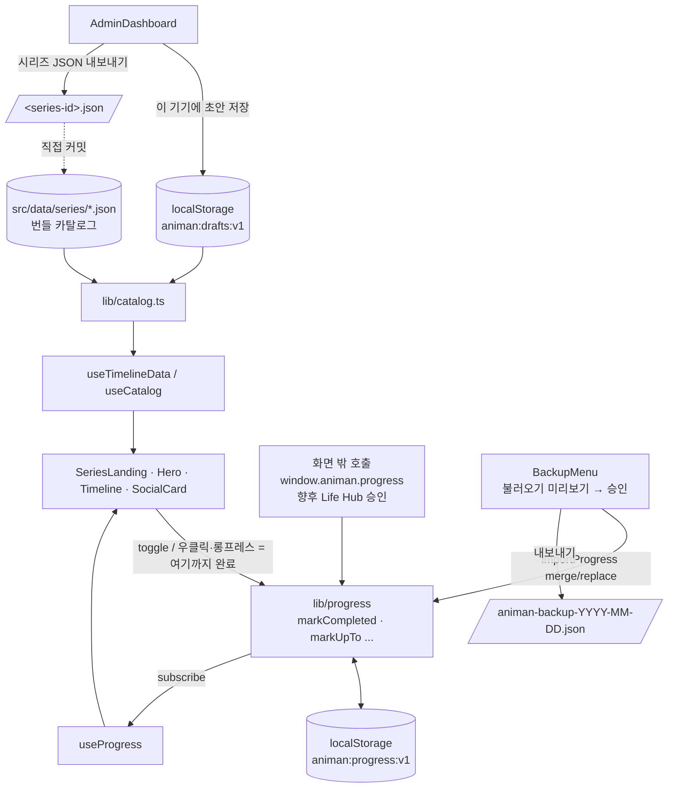
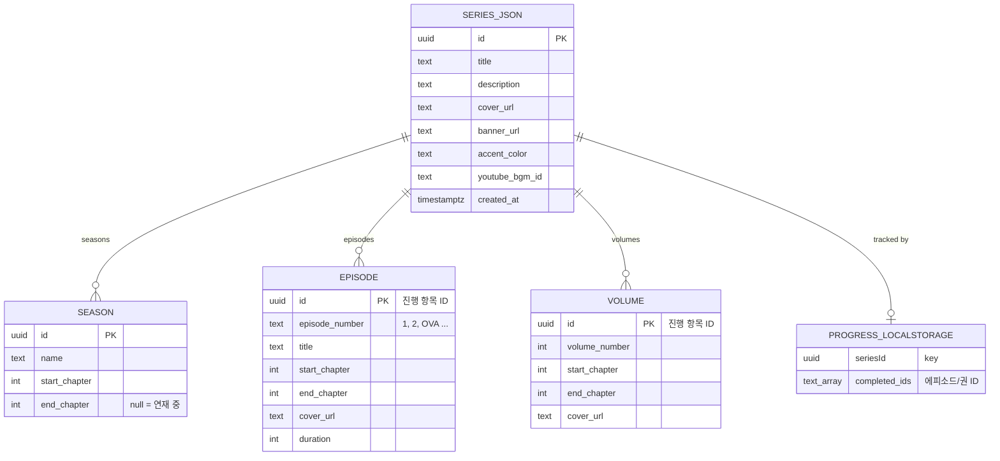
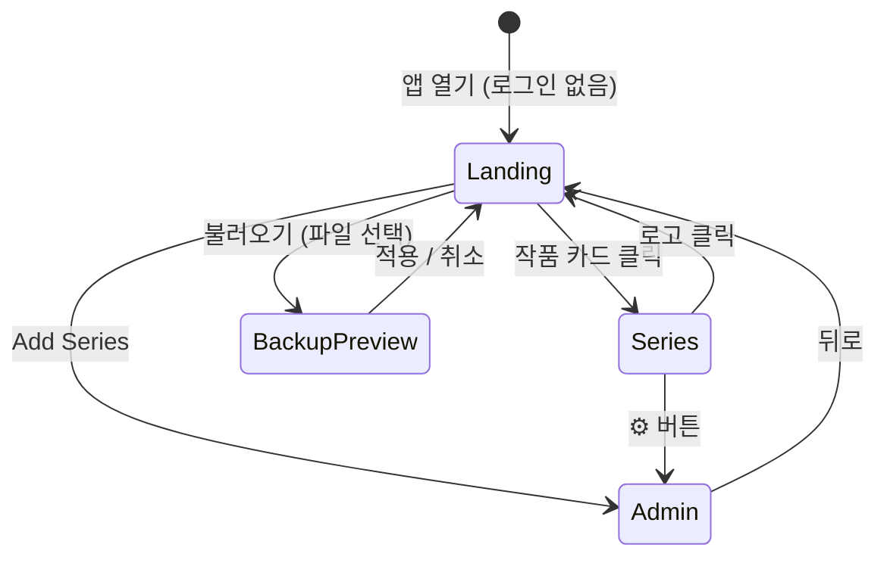

# AniMan Timeline Tracker

애니메이션 에피소드를 원작 만화 챕터 범위에 매핑해 타임라인으로 보여 주고, 어디까지 봤는지/읽었는지 기록하는 개인용 앱입니다.

- **서버 없음.** 시리즈 데이터는 이 저장소의 JSON으로 번들되고, 진행 기록은 **이 브라우저의 localStorage**에만 저장됩니다.
- **로그인 없음.** 이 기기 = 소유자입니다. 다른 기기로 옮길 때는 JSON 백업을 내보내고 불러옵니다.
- GitHub Pages로 정적 배포됩니다.

> ⚠️ 공개 저장소입니다. 개인 진행 기록 백업(`animan-backup-*.json`), 토큰, Supabase 키는 커밋하지 마세요. `.gitignore`가 백업 파일 이름 패턴과 `.env*`를 막아 둡니다.

---

## Architecture

```
src/
├── App.tsx                    # 화면 전환 (landing / series / admin)
├── data/series/*.json         # 번들 카탈로그 — 시리즈당 1파일 (공개 데이터)
├── components/
│   ├── SeriesLanding.tsx      # 작품 목록 + 진행률, 백업 메뉴 자리
│   ├── BackupMenu.tsx         # 진행 기록 백업 내보내기 / 불러오기(미리보기 → 승인)
│   ├── Header.tsx             # 시리즈 화면 상단 바
│   ├── Hero.tsx               # 시리즈 히어로 + 진행 바 + BGM
│   ├── Timeline.tsx           # 에피소드 ↔ 권 타임라인 (PC + 모바일)
│   ├── TimelineNode.tsx       # 타임라인 항목 (접근성 지원)
│   ├── SocialCard.tsx         # 공유용 진행 카드
│   ├── AdminDashboard.tsx     # 로컬 편집 → 시리즈 JSON 내보내기
│   └── ErrorBoundary/
├── hooks/
│   ├── useProgress.ts         # 진행 기록 구독 (반환 형태는 기존과 동일)
│   ├── useCatalog.ts          # 카탈로그(번들 + 로컬 초안) 구독
│   ├── useTimelineData.ts     # 선택한 시리즈 → TimelineData
│   ├── useHoverMapping.ts     # 챕터 범위 겹침 하이라이트
│   └── useAccentColor.ts
├── lib/
│   ├── progress/              # ★ 진행 기록을 바꾸는 유일한 모듈 (React 비의존)
│   │   ├── store.ts           #   markCompleted / unmarkCompleted / toggleCompleted / markUpTo / importProgress
│   │   ├── backup.ts          #   백업 형식, 검증, 불러오기 미리보기
│   │   └── index.ts           #   공개 API (window.animan.progress 로도 노출)
│   ├── catalog.ts             # 번들 JSON + 로컬 초안 병합, TimelineData 변환
│   ├── seriesBuilder.ts       # Admin 입력 ↔ 시리즈 레코드 (ID 유지)
│   ├── storage.ts             # 안전한 localStorage 래퍼
│   └── download.ts
└── types/index.ts
scripts/
└── export-supabase-catalog.mjs  # (1회용) Supabase → src/data/series/*.json
```

### Data Flow



### Data Model



필드 이름은 기존 Supabase 컬럼명과 같고, **모든 id는 기존 UUID를 그대로 유지**합니다. 그래서 진행 기록(`{ [seriesId]: completed_ids }`)이 Supabase 시절 형식과 1:1로 맞습니다.

### View Flow



---

## 진행 기록 API (화면 밖에서도 사용)

진행 기록은 `src/lib/progress`만 바꿉니다. React 컴포넌트, 콘솔, 향후 Life Hub 연동(Claude 제안 → 앱에서 승인) 모두 같은 함수를 씁니다.

```ts
import { markCompleted, markUpTo, unmarkCompleted, toggleCompleted, importProgress, getProgress } from './lib/progress';

markCompleted(seriesId, ['<episode-or-volume-id>']); // 합집합, 새로 추가된 ID 반환
markUpTo(seriesId, 'episode', 12);                    // 원작 챕터 순서로 12화까지 완료
markUpTo(seriesId, 'volume', 3);                      // 3권까지 완료
unmarkCompleted(seriesId, ['<id>']);
importProgress({ [seriesId]: ['<id>'] }, 'merge');    // 'merge'(합집합) | 'replace'
```

브라우저 콘솔에서는 `window.animan.progress.markUpTo(...)` 로 같은 API를 호출할 수 있습니다.

### 백업 형식

```json
{ "app": "animan", "version": 1, "exportedAt": "2026-01-01T00:00:00.000Z",
  "progress": { "<seriesId>": ["<episode-or-volume-id>", "..."] } }
```

작품 목록 화면 오른쪽 위 **백업 내보내기 / 불러오기**. 불러오기는 미리보기(작품별 현재 → 적용 후, 추가/제거 수, 카탈로그에 없는 ID 경고)를 보여 주고, **합치기(기본, 합집합)** 또는 덮어쓰기를 고른 뒤 **적용**해야 반영됩니다.

---

## 콘텐츠 추가 / 수정

1. 앱에서 **Add Series**(또는 시리즈 화면의 ⚙) → Admin Dashboard.
2. 새 작품이면 그대로, 기존 작품이면 **편집 대상**에서 선택 (JSON에 기존 id가 들어 있어 저장해도 ID가 유지됩니다).
3. **이 기기에 초안 저장** → 앱에서 바로 확인 (카드에 `로컬 초안` / `로컬 수정` 배지).
4. **시리즈 JSON 내보내기** → 받은 `<series-id>.json`을 `src/data/series/`에 넣고 커밋·푸시.
5. 배포 후 Admin의 초안 목록에서 해당 초안을 삭제 (같은 id의 초안은 번들보다 우선하므로).

Episodes/Volumes JSON 입력 예:

```json
{
  "seasons":  [{ "name": "1기", "startChapter": 1, "endChapter": 40 }],
  "episodes": [{ "number": 1, "title": "...", "startChapter": 1, "endChapter": 3, "duration": 24 }],
  "volumes":  [{ "number": 1, "startChapter": 1, "endChapter": 9 }]
}
```

---

## Supabase에서 이전하기 (1회)

기존 Supabase 데이터는 이 순서로 옮깁니다. 진행 기록(user_progress)은 샘플 데이터라 옮기지 않습니다. (필요하면 위 백업 형식으로 만들어 불러오면 ID가 그대로 맞습니다.)

1. **카탈로그 내보내기** — series/seasons/episodes/volumes는 anon 읽기가 허용돼 있어 URL + anon 키만 있으면 됩니다. 키는 환경변수로만 넘기고 파일에 저장하지 마세요.

   ```bash
   SUPABASE_URL=https://<project>.supabase.co SUPABASE_ANON_KEY=<anon-key> npm run export:catalog
   ```

   `src/data/series/<series-id>.json`이 시리즈별로 생성됩니다(모든 UUID 유지). 이미 있는 파일 중 Supabase에 없는 것은 경고만 하며, `-- --clean`을 붙이면 삭제합니다.

2. **확인 후 커밋**

   ```bash
   npm run dev
   ```

   ```bash
   git add src/data/series && git commit -m "Import catalog from Supabase"
   ```

3. **정리 (이전이 끝난 뒤, 선택)**
   - `supabase/` 폴더(마이그레이션 SQL)는 더 이상 앱에서 쓰지 않습니다. 이전이 끝나면 삭제해도 됩니다.
   - Supabase 프로젝트 일시정지/삭제, GitHub 저장소 secrets의 `VITE_SUPABASE_URL` / `VITE_SUPABASE_ANON_KEY` 삭제, 로컬 `.env` 삭제.

---

## Setup

Node.js 20 권장. 환경변수는 필요 없습니다.

```bash
npm install
```

```bash
npm run dev
```

| Script | 설명 |
|---|---|
| `npm run dev` | 개발 서버 (`http://localhost:5173/AniMan/`) |
| `npm run build` / `npm run preview` | 프로덕션 빌드 / 미리보기 |
| `npm run lint` / `npm run typecheck` | ESLint / TypeScript |
| `npm test` | 단위 테스트 (Vitest — 진행 저장소, 백업, Admin 빌더) |
| `npm run test:e2e` | Playwright E2E (dev 서버 자동 실행) |
| `npm run export:catalog` | Supabase → 카탈로그 JSON (1회용) |

### 테스트

- 단위/E2E 테스트는 **합성 데이터만** 사용합니다. E2E는 합성 시리즈를 로컬 초안으로 주입해 실행하므로 카탈로그가 비어 있어도 동작합니다.
- 처음 E2E를 돌릴 때 브라우저 설치: `npx playwright install chromium`. 이미 설치된 Chromium을 쓰려면 `PW_CHROMIUM_PATH=/path/to/chrome npm run test:e2e`.

### CI / 배포

- `.github/workflows/ci.yml`: PR과 main push마다 lint → typecheck → unit → build → e2e(Chromium).
- `.github/workflows/deploy.yml`: main push 시 GitHub Pages 배포 (시크릿 불필요).

---

## Key Design Decisions

- **로컬 우선**: 혼자 쓰는 앱이라 인증·승인·RLS를 없애고, 진행 기록은 브라우저에 둡니다. 기기 간 이동/보관은 JSON 백업으로 합니다.
- **카탈로그 = 코드**: 공개 데이터인 시리즈 정보는 PR로 리뷰·이력 관리됩니다. 시리즈당 1파일이라 diff가 작습니다.
- **ID 안정성**: 진행 항목 ID는 에피소드/권 UUID입니다. 내보내기 스크립트와 Admin 편집 모두 기존 ID를 유지하며, 새 항목만 `crypto.randomUUID()`로 만듭니다.
- **단일 쓰기 경로**: 진행 기록 변경은 `lib/progress`의 함수로만 일어나므로, 이후 외부 제안(Life Hub) 승인 흐름을 같은 함수 위에 붙일 수 있습니다.
- **챕터 범위 매핑**: 별도 매핑 테이블 없이 `start_chapter` / `end_chapter`로 겹침을 메모리에서 계산합니다.
